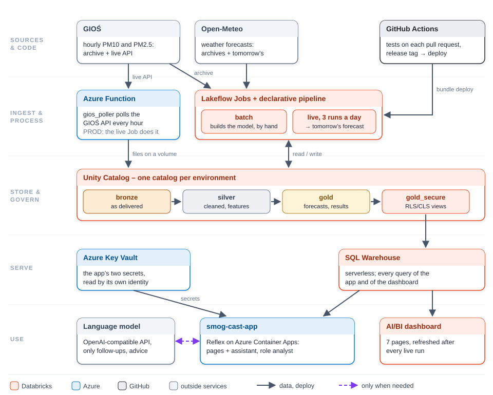
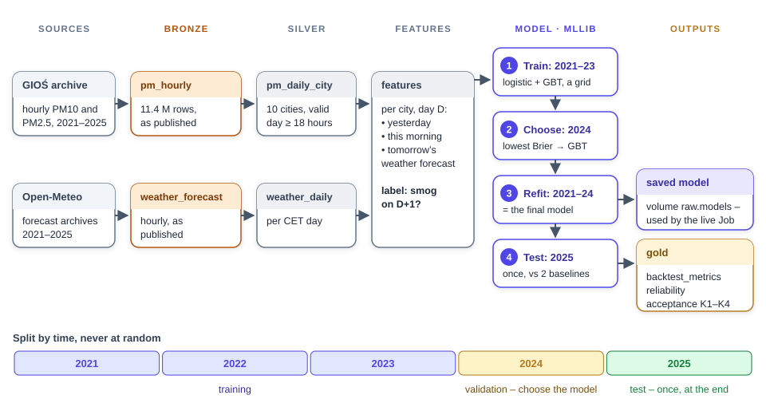
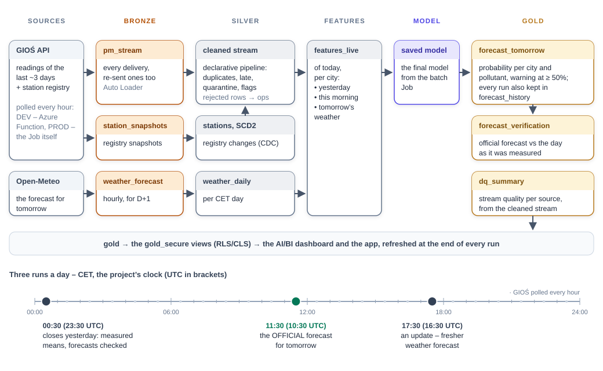
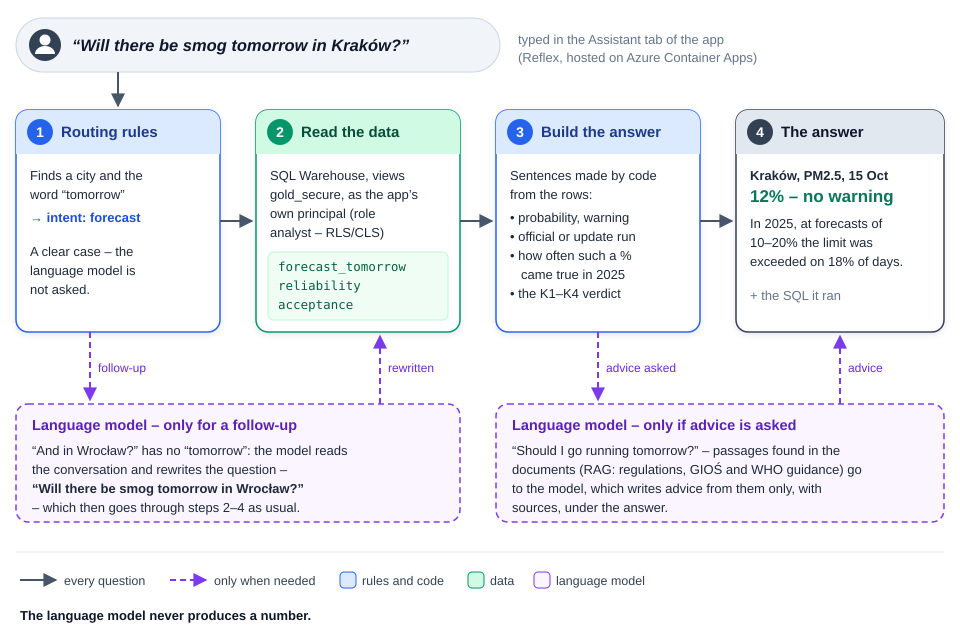

# smogcast architecture

The question the platform answers:

> **"Will the daily PM10 / PM2.5 limit be exceeded tomorrow in city Y, and how sure is that?"**

Definitions (a day in CET, a valid day needs at least 18 hours, limits 50 / 25 µg/m³): section 11.1.

## The system at a glance

Three repositories, one product:

| Repository | What it holds | Deployed by |
|---|---|---|
| **`smog-cast-dbr`** (this one) | the data pipeline: one wheel per step (`packages/*`), the declarative stream pipeline, the Azure Function that polls the GIOŚ API, the Asset Bundle (Jobs, pipeline, dashboard), CI/CD | `databricks bundle deploy`, from a laptop or GitHub Actions |
| **`smog-cast-terraform`** | everything around the pipeline: Unity Catalog objects, Key Vault and secret scope, service principals, groups for RLS/CLS, the function app and its storage, the SQL Warehouse settings, the app's hosting | `terraform apply`, by a person |
| **`smog-cast-app`** | the web app (Reflex): forecast pages and the AI assistant (deterministic forecast answers + RAG over the documents) | a container image, GitHub Actions |

The whole infrastructure (DEV):

Who runs what: the Jobs and the pipeline run as the service principal `sp-smogcast-<env>`, the function writes with a
managed identity, the app reads as its own service principal with the `analyst` role. No person and no stored key is
on the data path. PROD on the course's shared account has no Azure resources of its own: the live Job polls the GIOŚ
API itself (section 10).

Four pictures (`images/`) describe the system: this one, the two Jobs (sections 3 and 3a) and what happens when
someone asks the assistant about tomorrow (section 8).

---

## 1. Data flow

Three paths meet in the gold layer:

| Path | Job | From → to |
|---|---|---|
| **A – history and model** | batch (section 3) | the GIOŚ archive and weather-forecast archives → bronze → silver → features → the model → backtest results and the verdict K1–K4 |
| **B – live** | live, 3 times a day (section 3a) | the GIOŚ API → the stream cleaned by the declarative pipeline → today's features → the saved model → **tomorrow's forecast**, later compared with what was measured |
| **C – CDC** | live (section 3a) | snapshots of the GIOŚ station registry → changes → an SCD2 table of stations |

All gold tables are read through the secured views `gold_secure` (RLS/CLS, section 4a) by the dashboard and the app.

**Why it is built this way:**
- **The model is tested where it is used.** The backtest covers 2021–2025 in the same 10 cities it forecasts for.
- **Features use only what is known when the forecast is issued** (day D, 12:00 CET), and "tomorrow's weather" comes
  from **forecast archives**, never from the weather that actually happened – otherwise the backtest would look better
  than reality. Training uses the `short_range` archive; validation and test use **real forecasts issued the day
  before** (`day_ahead`, available from 2024-01-19).
- **The criteria for "the model can be trusted" (K1–K4) were frozen before training** – section 11.2.
- **Dirty data is injected on purpose, on a separate track** (`fault_replay`): a **copy** of real readings is replayed
  as a stream with injected faults. The history the model learns from never sees it (decision D17). The GIOŚ archive
  is verified and clean (0 rows quarantined, 0.1% flagged), so without this the cleaning would have nothing to show.

## 2. Wheels and Jobs (every step is its own wheel)

| Wheel | Steps (`--step`) |
|---|---|
| `smogcast-core` | no steps – shared code: configuration, Spark session, storage, data-quality rules, runner, CET/UTC time, gold data dictionary |
| `smogcast-ingest` | `gios-archive`, `weather-forecast-history`, `gios-live`, `gios-registry`, `weather-forecast-live`, `fault-replay` |
| `smogcast-bronze` | `station-meta`, `pm-hourly`, `weather-forecast`, `station-snapshots` |
| `smogcast-silver-clean` | `pm-hourly`, `pm-stream` (local only), `stations-scd2`, `fault-reset`, `live-reset` |
| `smogcast-silver-transform` | `pm-daily`, `weather-daily`, `features`, `features-live`, `pm-daily-live` |
| `smogcast-model` | `train`, `backtest`, `forecast` |
| `smogcast-gold` | `dq-summary`, `measured-daily`, `governance` |
| `smogcast-cli` | local only: `run-batch`, `run-live`, `run-fault-demo` – the same orders as the Jobs |

| Where | Who runs the steps | How |
|---|---|---|
| locally (Docker) | `smogcast-cli` | `smogcast run-batch`, or `smogcast run <package> <step>` |
| Databricks | Lakeflow Jobs: `resources/job_smogcast.yml` (history → model), `resources/job_smogcast_live.yml` (live, 3 times a day), `resources/job_smogcast_fault_demo.yml` (by hand) | a task is a `python_wheel_task` with the step's wheel + `smogcast-core`, parameters `--step … --env dev/prod` |

Tomorrow's forecast is the step **`model forecast`**, not a `gold` step: it needs the saved model and `prepare` from
the model package, and step packages never import each other.

Rules: step packages import only `core`; all wheels carry the same version (`VERSION`, a test checks it); the
namespace is `smogcast.*` (PEP 420). Transformations are pure functions DataFrame → DataFrame; a step is a function
`(Context) -> None` in its package's `STEPS` registry; everything that depends on the environment lives in
`smogcast-core` and `conf/<env>.yaml`.

## 3. Batch Job: history → the trained model (path A)

Run by hand when the model has to be (re)built – about one hour. How information flows through it:

- **The saved final model is the bridge to the live Job** (section 3a): every forecast loads it, the same model that
  was judged on the test year.
- The weather for training comes from fresh short-range forecasts; for validation and test from **real forecasts
  issued the day before** (D7), so the 2025 result matches what the model really gets.
- The last task, `gold governance`, documents the gold tables and rebuilds the secured views (section 4a).
- The tasks follow `BATCH_ORDER` in `packages/cli/src/smogcast/cli/main.py` – both places change together (the test
  `packages/cli/tests/test_cli.py` checks it). On DEV the Job takes about one hour, 35 minutes of it training.

## 3a. Live Job: three runs a day → tomorrow's forecast (paths B and C)

**The GIOŚ API is polled by an Azure Function, not by the Job.** The function `gios_poller` writes a registry
snapshot and a batch of readings to the external volume `raw.landing_live` every hour at :25 UTC. **The Job runs 3
times a day** – **10:30 UTC = 11:30 CET** (the official forecast: every model input is there, including the morning
00–10 CET, and the run ends before 12:00 CET), **16:30 UTC** (an update during the day) and **23:30 UTC = 00:30 CET**
(closes the day). The schedule is in UTC because the project's day is CET all year (D13); the variable
`live_trigger_pause_status` switches it on per target. Each run processes every batch collected since the previous
one, so the cluster starts 3 times a day instead of 24. Locally the two polls are the steps `ingest gios-registry` and
`ingest gios-live` (`smogcast run-live`, `LIVE_ORDER`) – the same logic (`smogcast.ingest.live_poll`).

How information flows through one run:

- **The forecast:** today's features go through the saved model → a probability per city and pollutant for tomorrow
  in `gold.forecast_tomorrow` (the newest run) and `gold.forecast_history` (every run, labelled – section 7).
- **The check:** once a day is over, its measured daily means (`gold.measured_daily`) are compared with the official
  forecast for it (`gold.forecast_verification`) – the live Brier score.
- Readings that break the rules land in `ops.pm_stream_quarantine` and `ops.pm_late_rejected`, never in silver
  (section 3b).
- The last task `dashboard_refresh` (`dashboard_task`) recomputes the AI/BI dashboard, so after every run it opens
  with current numbers. Every task of every Job has 2 retries 10 minutes apart and a time limit; a run that still
  fails e-mails `var.notification_email`.

**One first task per Job.** Every task installs `smogcast-core` and its step wheel on the Job's cluster, and
`smogcast-core` is not on PyPI. When two first tasks installed at the same time on a fresh cluster, the step wheel was
once resolved before `smogcast-core` was there; the cluster remembers a failed install, so the retries failed too
(DEV, 2026-10-13 23:30 UTC, no forecast from that run). So the weather task waits for the first task (live Job:
`bronze_station_snapshots`, on PROD `ingest_gios_registry` before it; batch Job: `ingest_gios_archive`) – an install
order, not a data dependency; `test_every_job_starts_with_one_task` keeps it so.

**Data-quality demo** (`smogcast run-fault-demo`): `fault-reset` → `fault-replay` → `station-snapshots` →
`stations-scd2` → `pm-stream` → `dq-summary` – the same faults from scratch every time; the `live` source is not
touched. On Databricks this is the **Job `smogcast-fault-demo`** (`resources/job_smogcast_fault_demo.yml`): the same
steps, started by hand (about 15 minutes, run before a presentation), with a **full refresh of the pipeline** instead
of `pm-stream`. The stream tables belong to the pipeline there (`storage.stream_tables_owner: pipeline` in
`conf/<env>.yaml`), so `fault-reset` removes only the demo files and the demo entries of the station registry; the
full refresh rebuilds the stream tables from the files in landing, the live ones included – nothing is lost.

## 3b. Declarative pipeline `smogcast-stream`

On Databricks the stream is cleaned by a Lakeflow declarative pipeline
([`pipelines/smogcast_stream/transformations/stream.py`](pipelines/smogcast_stream/transformations/stream.py),
resource [`resources/pipeline_smogcast_stream.yml`](resources/pipeline_smogcast_stream.yml)), started by the live Job
(task `stream_pipeline`). Locally the step `silver-clean pm-stream` computes the same tables.

The flow inside: Auto Loader reads the files of `landing_live/gios_live` (and `landing/fault_replay`) into the
streaming table `bronze.pm_stream`; the view `stream_readings` keeps one row per reading; from it, late readings go to
`ops.pm_late_rejected`, broken ones to `ops.pm_stream_quarantine`, and the rest – through the rules that drop
(`stream_accepted`) and the rules that only flag – to `silver.pm_stream`.

| Expectation | Where | Mode | What it catches |
|---|---|---|---|
| `known_source` | bronze | **fail** (stops the update) | a damaged batch file |
| `hour_parsed`, `station_given` | bronze | warn | unreadable hour, missing station code |
| `arrived_on_time` | stream_accepted | **drop** → `ops.pm_late_rejected` | late readings (judged at first arrival) |
| `known_station` | stream_accepted | **drop** → quarantine `unknown_station` | a station outside the cities' registry |
| `value_present`, `value_not_below_min`, `value_not_above_max` | stream_accepted | **drop** → quarantine `missing_value` / `below_min` / `above_max` | empty value, < 0, > 1000 µg/m³ |
| `not_frozen`, `not_spike`, `not_drift` | silver.pm_stream | warn (the row stays, flagged) | frozen sensor, spike, drift |

- **One definition, two ways to run it:** every table is a function from `smogcast.silver_clean.pm_stream`; the rules
  are the same SQL strings the local step filters with, so the pipeline UI counts exactly what lands in quarantine and
  in the late table. The test `test_pipeline_definition.py` guards the graph and the rules.
- **Tables recomputed from bronze:** a reading is judged at its **first** arrival and carries its **newest** value
  (the GIOŚ API returns about 3 days back on every call, so every reading arrives many times). Quarantine is the
  current state: a value GIOŚ fills in later moves to silver, a value GIOŚ withdraws moves to quarantine.
- **Compute:** serverless (the bundle installs the wheels through `environment`). The streaming table is created with
  `CREATE_TABLE`; the cleaned tables are materialized views and need `CREATE_MATERIALIZED_VIEW` for the identity the
  pipeline runs as.
- **On DEV:** an update takes about 1.5 minutes. First run on the rebuilt workspace (2026-10-12): 98 batches →
  391,252 records → 13,260 unique readings; 12,377 in silver (1 spike), 883 in quarantine (6.66%, empty values),
  0 late.

## 4. Tables

Locally: `data/delta/<layer>/<table>/`; on Databricks: `smogcast_<env>.<layer>.<table>`.

| Table | Key / partition | Write | Description |
|---|---|---|---|
| `bronze.gios_stations` | station_code | overwrite | stations from the GIOŚ metadata, **closed ones too**: town, coordinates, operating dates, old codes |
| `bronze.gios_positions` | position_code | overwrite | sensors (e.g. `MpKrakAlKras-PM10-1g`): pollutant, averaging time, measurement type |
| `bronze.pm_hourly` | station_code, pollutant, time_utc / partition `source_year` | replaceWhere per year | every station, PM10 and PM2.5, hourly values as published; `time_utc` = start of the hour; 2021–2025: 11.4 million rows |
| `bronze.weather_forecast` | city_id, source, time_utc | overwrite | hourly forecast; `source` = `short_range` (2021+) / `day_ahead` (from 2024-01-19) / `live` |
| `silver.station_city` | station_code | overwrite | station → city (by the town in the metadata), old codes → today's code |
| `silver.pm_hourly` | station_code, pollutant, time_utc / partition `source_year` | overwrite | stations of the 10 cities only; `dq_flag` (`ok` / `frozen` / `spike`), `is_valid`, `day_cet`, `hour_cet`; 2.1 million rows |
| `silver.pm_daily_station` | station_code, pollutant, day_cet | overwrite | daily mean (valid with ≥ 18 h), morning mean (00–10 CET) |
| `silver.pm_daily_city` | city_id, pollutant, day_cet | overwrite | max and mean over stations, `exceeded` (NULL = no data, not "no exceedance") |
| `silver.weather_daily` | city_id, source, day_cet | overwrite | forecast aggregated to the CET day: temperature, wind, calm hours, precipitation, … |
| `silver.features` | city_id, pollutant, issue_day | overwrite | features from D-1, D-2, the morning of D, the weather forecast for D+1, the calendar of D+1; label `exceeded_next_day`; `split`, `is_usable` |
| `gold.model_selection` | pollutant, model, params | overwrite | the parameter grid with the validation Brier score; `operational` = the model chosen on validation |
| `gold.backtest_predictions` | model, split, city_id, pollutant, issue_day | overwrite | probability vs outcome (validation 2024, test 2025), persistence and climatology included |
| `gold.backtest_metrics` | model, split, pollutant, city_id (+ `ALL`) | overwrite | Brier, BSS, POD, FAR, CSI, AUC |
| `gold.reliability` | model, split, pollutant, bin | overwrite | calibration: forecast vs observed frequency |
| `gold.acceptance` | pollutant, model, criterion | overwrite | the verdict K1–K4 on the test year |
| `bronze.station_snapshots` | snapshot_ts, station_id | overwrite | snapshots of the GIOŚ API station registry (`registry_source` = `gios_api` / `fault_replay`) |
| `silver.station_changes` | station_id, snapshot_ts | overwrite | CDC: differences between consecutive snapshots → INSERT / UPDATE / DELETE |
| `silver.stations` | station_id, valid_from | overwrite | SCD2 of the registry (`is_current`, `valid_to`) |
| `bronze.pm_stream` | – | streaming append (Auto Loader in the pipeline; locally a Delta sink with a checkpoint – exactly once) | raw stream readings, re-sent ones too; `source` = `live` / `fault_replay` |
| `silver.pm_stream` | source, station_code, pollutant, time_utc | recomputed from bronze (materialized view of the pipeline) | the cleaned stream: `dq_flag` (`ok` / `frozen` / `spike` / `drift`), `status` (`new` / `correction`), `lag_hours`, `n_received`; **separate from `silver.pm_hourly`** (D17) |
| `silver.features_live` | city_id, pollutant, issue_day | MERGE | features of the issue day D (today, CET) from `silver.pm_stream` (`live`) and the `live` weather forecast; `is_usable`, `unusable_reason` |
| `gold.forecast_tomorrow` | city_id, pollutant, target_day | MERGE | **the answer to the main question** – always the **newest** run: `probability`, `warned` (P ≥ 0.5), the operational model, `status` (`ok` / `no_forecast` with a reason), explanatory features, `jurisdiction_code` (for RLS), `run_kind`, `run_id`, `issued_at` |
| `gold.forecast_history` | run_id, city_id, pollutant, target_day | MERGE (every run adds its rows; a retried task overwrites its own) | **every** forecast run: the same columns + `run_kind` = `preliminary` (before 11:30 CET) / `official` (the first from 11:30 CET – the one compared with reality) / `update` |
| `silver.pm_daily_city_live` | city_id, pollutant, day_cet | overwrite (step `silver-transform pm-daily-live`) | measured daily means of the cities from the `live` stream – **finished CET days only**, the same functions and the same 18 h rule as the archive; no `fault_replay` (D17) |
| `gold.measured_daily` | city_id, pollutant, day_cet | overwrite (step `gold measured-daily`, batch and live Jobs) | **what was actually measured**: the archive 2021–2025 (`source = archive`, wins on overlap) + live (`live`); `max_station_mean_ug_m3`, `exceeded`, `heating_season` (`2024/25` = Oct–Apr, as the model feature) |
| `gold.forecast_verification` | city_id, pollutant, target_day | overwrite (the same step) | every **official** forecast next to the measurement of its target day: `outcome` = `hit` / `miss` / `false_alarm` / `correct_no_warning` / `no_forecast` / `no_data` / `pending`; `squared_error` → the live Brier score |
| `gold.dq_summary` | source, metric | overwrite | stream quality per source: unique readings, re-sent, late, quarantined by reason, flags; % of unique |
| `ops.pm_quarantine` | – | replaceWhere `source = 'archive'` | **archive**: readings that break the hard rules, with the reason |
| `ops.pm_stream_quarantine` | – | recomputed from bronze | **stream**: readings that break the rules or come from an unknown station, with the reason (current state) |
| `ops.pm_late_rejected` | – | recomputed from bronze | late readings (more than 3 h at first arrival and already due at the previous poll) |
| `ops.dq_metrics` | – | append | the log of quality metrics from every step |
| `ops.access_policy` | principal (+ region) | seeded from `conf/<env>.yaml`, then edited by an admin | who sees what in `gold_secure`: principal → `admin` / `analyst` / `region` + voivodeship |
| `gold_secure.<gold table>` | – | view (step `gold governance`) | **secured views** of every gold table: rows by voivodeship (RLS), `technical` columns masked (CLS) – section 4a |

Tables are owned by the Jobs' service principal. An admin reads them but cannot write: a forecast can only be
changed by the pipeline. The one exception is `ops.access_policy`: roles are managed by people, so the step
`gold governance` grants write access to that table to the principals in `governance.access_editors`
(`conf/<env>.yaml`).

### 4a. Governance: documented data, RLS and CLS

One source: the **gold data dictionary**
[`conf/gold_dictionary.yaml`](packages/core/src/smogcast/core/conf/gold_dictionary.yaml) (a description and a class
`business` / `technical` for every column). The step `gold governance` (the last one in the batch and live Jobs)
checks that every gold column is described (otherwise the Job fails and e-mails), writes the descriptions and the
`class` tags to Unity Catalog and creates **dynamic views** in `gold_secure`:

| Role of the reader | Where it comes from | Rows | `technical` columns |
|---|---|---|---|
| `admin` | a row in `ops.access_policy`, or the group `smogcast-admins` | all | visible |
| `analyst` | a row, or the group `smogcast-analysts` | all | NULL |
| `region` | a row with a voivodeship, or the group `smogcast-region-<code>` | only its voivodeship (+ the `ALL` rows) | NULL |
| none of these | – | none | – |

Views instead of native row filters and column masks on the tables, because a table with a filter or a mask rejects
Delta API writes from a single-user cluster. Grants (Terraform): the gold tables for admins only; `gold_secure` for
every group. The access table also works where nobody can manage account groups – **on the course's PROD the roles
come only from it**. Demo: change your own row in `ops.access_policy` to `analyst` or `region`, query
`gold_secure.forecast_tomorrow` (filter the newest `target_day`), change it back to `admin`.

### 4b. AI/BI dashboard

The reporting tool built into Databricks (menu **Dashboards**), deployed by the bundle like the Jobs:
[`resources/dashboard_smogcast.yml`](resources/dashboard_smogcast.yml) +
[`dashboards/smogcast.lvdash.json`](dashboards/smogcast.lvdash.json). The queries name no catalog – the bundle points
them at the **`gold_secure` views** (`dataset_catalog` = the environment's catalog, `dataset_schema = gold_secure`),
and `embed_credentials: false` means every viewer queries as themselves, so the dashboard honours RLS/CLS (the region
PL-12 sees only Kraków). The warehouse is found by name (`Serverless Starter Warehouse`, variable `warehouse_id` with
a `lookup`), so a new workspace needs no change in the code. The JSON is generated by
[`dashboards/make_dashboard.py`](dashboards/make_dashboard.py) (change the script, not the JSON).

| Page | Business question | Source |
|---|---|---|
| Tomorrow | where the limit may be exceeded tomorrow and how sure that is; why (yesterday, this morning, the weather); tiles with the PM10 and PM2.5 limits; a table of the inputs with a city filter. "Yesterday" / "This morning" = **the mean of the city's worst station**, not a single reading | `forecast_tomorrow` |
| Forecast updates | how today's forecast **for tomorrow** changed: preliminary → official → update for every city, PM10 and PM2.5 on a fixed 0–100% axis | `forecast_history` (the newest target day) |
| Measured | how many days above the limit in the heating season, the last 60 days | `measured_daily` |
| Did it come true? | do the official forecasts hold up live: a summary (✓/✗, the live Brier score) + a table day × city with the limit next to the number and a plain sentence, e.g. "✓ no smog, as forecast (6% chance → measured 18 µg/m³)" | `forecast_verification` |
| Test year 2025 | how the model did month by month in the test year: smog days caught / missed / false alarms, compared with "tomorrow like today"; a city filter | `backtest_predictions`, `model_selection` |
| Model | the trust tests named as questions (the codes K1–K4 only as a note), Brier vs "tomorrow like today" and the calendar average, calibration | `acceptance`, `backtest_metrics`, `reliability`, `model_selection` |
| Data quality | how many readings were set aside and why (live / fault_replay) | `dq_summary` |

## 5. Time (decision D13)

| Source | Convention in the source | In the tables |
|---|---|---|
| GIOŚ archive | **end** of the hour, **CET** (UTC+1 all year), millisecond noise in Excel | `time_utc` = **start** of the hour in UTC (`smogcast.core.timeutil`) |
| GIOŚ API (live, `getData`, `archivalData`) | **end** of the hour, local time Europe/Warsaw (with daylight saving) | as above |
| Open-Meteo | UTC (`timezone=GMT`) | as above |
| the "day" of a daily mean | – | `day_cet` = the calendar day in CET |

Example: the archive value "2025-01-01 01:00" is the hour 00:00–01:00 CET, so `time_utc = 2024-12-31 23:00`.
Conversions happen in one module only, `smogcast.core.timeutil`.

## 6. Model results (test year 2025)

The criteria were frozen before training (section 11.2). The results are **identical on a laptop and on Databricks**,
and identical on the DEV workspace rebuilt from scratch on 2026-10-12 (acceptance, metrics, model selection and
calibration compared value by value: 0 differences).

| | PM10 (GBT, depth 3, 100 trees) | PM2.5 (GBT, depth 5, 50 trees) |
|---|---|---|
| Brier: model / climatology / persistence | 0.0434 / 0.0615 / 0.0933 | 0.0751 / 0.117 / 0.172 |
| BSS vs climatology · AUC | 0.30 · 0.95 | 0.36 · 0.94 |
| POD / FAR | 44% / 32% | 70% / 27% |
| Calibration (K3, ≤ 15 pp) | 8.5 pp ✅ – **close to the limit, fragile** | 7.2 pp ✅ |
| Verdict K1–K4 | ❌ fails K4a (detection) | ✅ passes |

In plain numbers (all of 2025, 10 cities): PM2.5 had 697 smog days; the model warned on 490 of them (70%) and 490 of
its 667 warnings were followed by smog (73%); "tomorrow like today" caught 388 of 697 (56%). PM10 had 292 smog days;
the model caught 129 (44%) and 129 of its 189 warnings were right (68%); "tomorrow like today" caught 124 (42%) with
124 of 293 warnings right (42%).

**Why PM10 does worse than PM2.5:** PM2.5 is mostly combustion dust, which follows weather the forecast knows (frost,
calm wind). PM10 also contains coarser dust from streets, building sites and soil – factors the model does not have.
PM10 exceedances are also rarer (about 8% of days) and need a stronger episode. The PM10 model ranks days well
(AUC 0.95) but misses more than half of the exceedance days, and its calibration is close to the limit. This is
reported as it is; the criteria are not changed after the fact.

**Reproducibility:** GBT was sensitive to floating-point noise and to how the data was split into partitions
(different trees in Docker and on the cluster). So the features are rounded to 6 decimals (`prepare.ROUND_DECIMALS`)
and training gets its data in one ordered partition (`train.fit_input`).

**What kind of model it is:** supervised machine learning – binary classification (exceedance tomorrow: yes / no)
with a probability, Spark MLlib (gradient boosted trees; logistic regression as the comparison). Trained by the batch
Job on 2021–2024 and saved; the live Job loads the saved model for every forecast.

## 7. Live forecast

On every run of the live Job (locally `smogcast run-live`): the features of day D (today in CET) from the cleaned
`live` stream (the same functions and the same 18 h rule as the history) + the `live` weather forecast for D+1 → the
saved operational model → `gold.forecast_tomorrow`. A city without yesterday's PM data or without a complete weather
forecast gets a row `status = no_forecast` with the reason – never a guessed value.

**Run kinds.** The Job computes the forecast for D+1 three times on day D (00:30, 11:30, 17:30 CET). Every run gets
a label `run_kind` (`smogcast.model.forecast_runs`, threshold `official_from_cet` in `model.yaml`):

| Run | Label | Meaning |
|---|---|---|
| before 11:30 CET | `preliminary` | the morning 00–10 CET is incomplete – the model fills the gap; a situation the 2025 test did not judge |
| the first from 11:30 CET | `official` | the inputs are as in the test (D6); this forecast is compared with reality; also a rerun after a failure (e.g. 13:00) if there was no official one yet |
| every later one | `update` | the same readings, a fresher weather forecast |

`gold.forecast_tomorrow` always shows the newest run (with its label and `issued_at`), `gold.forecast_history` keeps
all of them. The run id is the Job run id (`{{job.run_id}}`, parameter `--run-id`): a retried task belongs to the same
run, so it neither duplicates the history nor changes the label.

**Checked on DEV:** all three labels from the schedule; an example of why the distinction matters – Kraków PM10 for
2026-10-10: preliminary 10.5% (no morning yet), official 2.4% (after the morning readings). Official forecasts judged
live so far (target days 2026-10-09 to 2026-10-11): 60 of 60 `correct_no_warning`, live Brier 0.0012 – clean autumn
days, e.g. Kraków PM10 on 11 October: forecast 2.4%, measured 13 µg/m³ against a limit of 50.

**Known limitation:** the set of live stations (API registry) is slightly larger than in the history (e.g. Warsaw 8 vs
6 PM10 stations). With "the city = its worst station", more stations mean a systematically higher maximum, so live
features can be slightly higher than in training.

## 8. Application: panel and assistant (repo `smog-cast-app`)

The app is a separate repository and a separate deployment. This repository is its **source of data and of the data
contract**; nothing in the app writes to the pipeline's tables. State of the app on 2026-10-12: all pages and the
assistant run on Azure Container Apps against the DEV workspace ✅, and locally in Docker.

The pages (Info · Tomorrow · City · Model · Data quality · Assistant) read the `gold_secure` views through the SQL
Warehouse; the assistant also has a knowledge-base index (documents + the gold data dictionary) and a language model.

**Data access.** The app reads `<catalog>.gold_secure.<table>` through the SQL Warehouse
(`databricks-sql-connector`) – no Spark and no Java in its image. Locally it uses the author's short-lived token; when
hosted it signs in as its own service principal `sp-smogcast-app-<env>` (OAuth machine-to-machine), a member of
`smogcast-analysts`, so it gets the `analyst` role: every row, `technical` columns as NULL. Locally a saved copy of
the views (DuckDB) is the fallback when the warehouse does not answer, and the interface says so; the copy is not in
the hosted image. Every view with data shows its SQL.

**The assistant.** Rules settle the certain cases; a language model only classifies the unclear ones and answers
from the documents – **it never produces a number**. What happens when someone asks in the Assistant tab whether
there will be smog tomorrow in a city:

The answer for Kraków on DEV on 2026-10-14 (one of its two paragraphs – the question names no pollutant, so it gets
PM10 and PM2.5): "**Kraków, 2026-10-15, PM2.5:** probability of exceeding the daily limit (25 µg/m³) = **12%** – no
warning (a warning is issued at 50% or more). Yesterday's highest station daily mean: 14 µg/m³, this morning:
20 µg/m³. Weather forecast for tomorrow: 9.6 °C, wind 2.3 m/s, 1 h of calm wind, precipitation 0.2 mm. How reliable
such a "12%" is: in the 2025 test year, at forecasts of 10%–20% the limit was exceeded on 18% of days (275 days).
Model: GBT · official forecast · issued 2026-10-14, 11:44 CET."

| Part | How it works |
|---|---|
| routing | rules first (refusals, greetings, dictionary lookups, "city + tomorrow"); the language model classifies the uncertain questions and follow-ups and rewrites them to stand alone ("Understood as: …"); without a model the rules alone still work |
| forecast answers | deterministic: the forecast, its calibration in 2025 and the K1–K4 verdict read from `gold_secure`, put into sentences by code; the language model is not asked |
| RAG | documents written for the assistant (`docs/rag/*.md`, English), official sources as downloaded (the Polish regulation, EU directives, GIOŚ and WHO guidance) and the gold data dictionary are cut into passages (about 1,200 characters, 200 overlap), embedded with `paraphrase-multilingual-MiniLM-L12-v2` (Polish questions find English passages) and searched with embeddings + BM25; answers come **only** from the retrieved passages and always show their sources |
| language model | any OpenAI-compatible endpoint (`SMOGCAST_LLM_*`); today Cerebras `gpt-oss-120b`; forecast answers, dictionary answers, greetings and refusals do not use it at all |
| checks | control questions on the real model and data (`tools/ask_eval.py`), unit tests of the routing, a smoke test of every page in 4 views; a test fails when the index is older than the documents |

**The data contract.** The app keeps copies of `conf/cities.yaml`, `conf/thresholds.yaml`, `conf/model.yaml`,
`conf/gold_dictionary.yaml` and `smogcast/core/schema.py` with checksums; they are changed only here. A new gold table
or column must be described in the dictionary, otherwise the step `gold governance` stops the Job.

**Hosting ✅ (DEV, since 2026-10-12).** Azure Container Apps (Terraform module `app_hosting`, section 10a): the
Container App `ca-smogcast-app-<env>` with one always-on replica (1.5 vCPU, 3 GiB – the conversations live in the
process's memory) and a public HTTPS address, the image from `ghcr.io`, the two secrets (the principal's OAuth secret
and the language-model key) read from Key Vault by the app's managed identity. A new image is built and put on the
app by `deploy.yml` of the app repo, started by hand and signed in through OIDC as a deploy identity that may change
this one app and nothing else. The app is hosted on DEV only; it joins PROD when PROD exists.

## 9. Tests and CI/CD

| Level | Where | What it checks | Time |
|---|---|---|---|
| unit | `packages/<package>/tests/` | pure DataFrame → DataFrame functions on small hand-built data: time conversions, quality rules (quarantine, frozen, spike, drift vs a real episode), the 18 h rule, **no leakage** in the features, metrics on a hand-computed example, the K1–K4 logic, GBT reproducibility, CDC/SCD2, the RLS/CLS views, API contracts (units, UTC), Jobs vs the local CLI, wheel versions | ~3 min |
| integration | `packages/cli/tests/test_integration.py` (marker `integration`) | the whole pipeline on data from `smogcast.ingest.synthetic` (files in the real source formats): history → model → 2× live → fault demo; layers not empty, a rerun without duplicates, model choice and K1–K4, tomorrow's forecasts, faults in quarantine / rejected / flags, CDC | ~3 min |
| on real data | by hand: `smogcast run-batch`, `run-live`, `run-fault-demo`; on DEV – the Jobs | results compared between a laptop and Databricks (the same verdicts and numbers) | tens of minutes |

The integration test found two bugs the unit tests did not see (the metadata parser on shorter xlsx rows, the number
of stations in the generator) – that is why it runs in CI.

The path of a change, three workflows:

| Workflow | When | What it does |
|---|---|---|
| `ci.yml` | every commit of a pull request | `ruff` → unit tests → the integration test (synthetic data, no internet) |
| `release-please.yml` | a merge to `main` | updates the release PR (next version + `CHANGELOG.md`); merging it creates the tag `vX.Y.Z` and sends it to DEV |
| `deploy.yml` | by hand, or called for a new tag | `bundle validate` → `bundle deploy` (builds and uploads the wheels) → on DEV also the function's code; PROD takes only a release tag |

A pull request can be tried on DEV before the merge ("deploy my branch to dev", one shared copy); the same tag that
went to DEV goes to PROD by hand. On DEV GitHub Actions signs in as the Jobs' service principal through OIDC – no
secret is stored; on the course's PROD, which has no principal for us, with a token kept as a secret of the GitHub
Environment `prod` (section 10). Tests are not rerun on deploy, and wheels are not
built separately in CI: `bundle deploy` builds them (section `artifacts`), and a build error stops the deploy before
anything reaches the workspace.

CI: [`.github/workflows/ci.yml`](.github/workflows/ci.yml) – Python 3.11, Java 17, `smogcast-core[local]` (PySpark and
delta-spark only locally and in CI; the wheels do not pull them, Databricks has its own).

## 10. Environments and deployment

| | local | DEV | PROD |
|---|---|---|---|
| where | Docker on a laptop | an Azure Databricks workspace in the author's subscription (Germany West Central, Hybrid) | a workspace on the course's account |
| storage | `data/delta/…` (`storage.mode: path`) | `smogcast_dev.<layer>.<table>`, volumes `smogcast_dev.raw.*` | `smogcast_prod…` |
| runs the steps | `smogcast run-…` | Lakeflow Jobs from the bundle (one shared copy in `/Workspace/Shared`, names `[dev] …`) | the same Jobs (`mode: production`) |
| identity of the Jobs | – | service principal `sp-smogcast-dev`: the Jobs and the pipeline run as it (`run_as`) and belong to it (`IS_OWNER` in the bundle); it owns the tables, admins read | a service principal (`run_as`) |
| deploys | – | `databricks bundle deploy -t dev` from a laptop (the group `smogcast-admins` holds the Service Principal User role) or CI as the principal | **CI only** (GitHub Actions) |
| state | ✅ | ✅ rebuilt from scratch on a new subscription on 2026-10-12, model identical | 🔜 |

- The environments differ **only** in `conf/<env>.yaml` and in the targets of `databricks.yml` (host, VM type,
  `run_as`).
- Single-user Job clusters carry no user name: Databricks assigns them to the identity the Job runs as, whoever
  deployed the bundle.
- **Live ingestion outside Databricks:** the Azure Function `gios_poller`
  ([`functions/gios_poller/`](functions/gios_poller/), Flex Consumption, Python 3.11) writes a registry snapshot and a
  batch of readings every hour at :25 UTC to the container `live` of a storage account that Unity Catalog exposes as
  the **external volume** `<catalog>.raw.landing_live` (access connector → storage credential → external location).
  Managed identities only, no keys. The function's code is deployed from this repository (`build.sh` →
  `az functionapp deployment source config-zip`), its infrastructure from the Terraform repository. Logs: Application
  Insights `appi-<function app>`.
- The run at 23:30 UTC (00:30 CET) already belongs to the next issue day: it computes a preliminary forecast for the
  day after tomorrow without the morning; the official one follows at 10:30 UTC.

| Element | DEV (2026-10-12) |
|---|---|
| Function App / storage | `func-smogcast-poller-dev-adam2` / `stsmogcastlivedevadam2` → `smogcast_dev.raw.landing_live`; a batch every hour |
| live Job | schedule `0 30 10,16,23 * * ?` UTC; first scheduled run 10:30 UTC: 13 of 13 tasks as the principal, 19.6 min, the `official` forecast for 2026-10-13 |
| batch Job | 13 of 13 tasks, 60 min (35 min training), no retries |
| SQL Warehouse | "Serverless Starter Warehouse", 2X-Small, 1 minute auto-stop (about 17 s to wake) |

### 10a. Infrastructure (repo `smog-cast-terraform`)

Terraform creates everything around the pipeline; the workspace itself is created by hand and only referenced (its
host is needed before anything inside it can be planned, and destroying it would delete the data). State: an Azure
storage account, one container per environment, Entra ID authentication – no keys in files.

| Module | Creates | Why |
|---|---|---|
| `unity_catalog` | the catalog `smogcast_<env>`, schemas `bronze` `silver` `gold` `ops` `raw` `gold_secure`, volumes `landing` `checkpoints` `models` | the medallion in Unity Catalog; paths match `conf/<env>.yaml` |
| `secrets` | Key Vault + the Key Vault-backed secret scope `smogcast` | secrets stay in Key Vault; values are set with `az keyvault secret set`, never in the state |
| `identity` | the Entra ID application and service principal `sp-smogcast-<env>`, the same principal in the workspace, its grants on the catalog, the Service Principal User role for the deployers' group, GitHub OIDC credentials | Jobs run as a principal, not a person; CI deploys without a secret |
| `governance` | account groups `smogcast-admins`, `smogcast-analysts`, `smogcast-region-<code>`, their grants (gold tables for admins only, `gold_secure` for every group), members | RLS by voivodeship, CLS on technical columns (section 4a) |
| `live_ingest` | storage (ADLS Gen2), the function app `gios_poller` with a user-assigned identity and Application Insights, access connector → storage credential → external location → external volume `raw.landing_live` | hourly polling without starting a cluster; the files land where Auto Loader reads them |
| `app_hosting` | the app's service principal in `smogcast-analysts`, its identity with read access to the vault's secrets, Log Analytics, the Container Apps environment and the Container App, a deploy identity with GitHub OIDC. On DEV the environment is in Poland Central: Germany West Central had no capacity for a new one | the app reads `gold_secure` as an analyst; its secrets never leave Key Vault |
| root | adopts the workspace's "Serverless Starter Warehouse" and keeps it at 2X-Small with 1 minute auto-stop | at its default size (Small, 10 minutes) the warehouse was 42.7 of the first 48.7 EUR spent |

What a workspace built from scratch taught (2026-10-12): the workspace must be of type **Hybrid** (a Serverless
workspace has no classic clusters for the Jobs); whoever deploys a Job that runs as a principal needs the **Service
Principal User** role on it, being a workspace admin is not enough; the pipeline's identity needs
**`CREATE_MATERIALIZED_VIEW`**; everything that used to work "because the author owned the tables" has to be granted
to the principal explicitly. The first deploy from CI (2026-10-13) added one more: a bundle makes whoever deploys the
**owner** of its Jobs and pipelines, and only a workspace admin may change an owner – so the owner is named in the
bundle (the principal), and a laptop and CI can both deploy the same copy.

**PROD (course account, shared):** common objects of the course (its catalog, Key Vault, service principal,
warehouse) are only referenced, never created, imported or resized; no own principal and no account groups there –
roles come from `ops.access_policy`; every Azure resource needs the tag the course's policy requires.

## 11. Design decisions and definitions

The project's lasting agreements; comments in the code and in the configuration files refer to them.

### 11.1 The question and definitions

> **"Will the PM10 / PM2.5 limit be exceeded tomorrow in city Y, and how sure is that?"**

| Term | Definition in the project | Source |
|---|---|---|
| day | a calendar day in **CET** (UTC+1, no daylight saving) – the way GIOŚ counts | the GIOŚ archive publishes data in CET |
| station daily mean | the mean of the hourly values; **valid only with ≥ 18 of 24 hours** (75%) | EU completeness criterion (directive 2008/50/EC) |
| PM10 exceedance | daily mean > **50 µg/m³** | the limit value (PL/EU), GIOŚ API `levels/getPermissible`; 35 days a year are allowed |
| PM2.5 exceedance | daily mean > **25 µg/m³** (configurable) | Polish law has no daily PM2.5 limit today; 25 µg/m³ is the daily limit value of the new EU directive 2024/2881 (from 2030); alternative: 15 µg/m³ (WHO 2021) |
| exceedance in a city | **at least one** station of the city has a valid daily mean above the limit | the way GIOŚ reports (an exceedance at a sensor); decision D4 |
| "how sure" | a **probability** from the model (0–100%), checked for **calibration**: of the days forecast at "70%", about 70% should exceed | section 6 |
| "tomorrow" | day D+1; the forecast is issued on day D at 12:00 CET (data up to 11:00 + the weather forecast for D+1) | decision D6 |

**Thresholds live in the configuration** (`conf/thresholds.yaml`), not in the code – each with its source.

### 11.2 Criteria K1–K4

When the model counts as trustworthy – frozen on 2026-10-01, before any training.

Backtest on the test year (2025), which the model never saw; the weather comes from real forecasts issued the day
before. **All** criteria must hold (`conf/model.yaml`, `model.acceptance`):

| # | Criterion | In plain words |
|---|---|---|
| K1 | Brier skill score > 0 against **climatology** | the probabilities beat the calendar average |
| K2 | Brier score lower than **persistence** | the model adds something over "tomorrow like today" |
| K3 | Calibration: in every forecast bin with ≥ 30 days, \|forecast − frequency\| ≤ 15 pp | "70%" means about 70% |
| K4 | PM10: POD ≥ 60% and FAR ≤ 50% (a warning at P ≥ 0.5) | it catches most smog days and does not raise a false alarm every other time |

The thresholds are sensible starting values, not an industry standard. **They are not changed after the results are
known.** A criterion that fails is reported as it is.

### 11.3 Decisions D1–D17

D1, D2, D14 and D15 were confirmed by the author (2026-10-01). The others are defaults chosen with a reason –
changing them touches only the configuration. D16 concerned how the work was organised, not the system, and is left
out.

| ID | Decision | Reason |
|---|---|---|
| D1 | Project name: **`smogcast`** (Python namespace `smogcast.*`, local CLI `smogcast …`) | confirmed by the author |
| D2 | Cities: **the 10 largest cities of Poland** – Warszawa, Kraków, Wrocław, Łódź, Poznań, Gdańsk, Szczecin, Bydgoszcz, Lublin, Białystok | checked in the API on 2026-10-01: each has 3–14 PM10 and 3–10 PM2.5 sensors, each lies in a different voivodeship (good for RLS); a mix of smoggy cities (Kraków, Łódź) and cleaner ones (Gdańsk, Szczecin); the list is in `conf/cities.yaml` |
| D3 | Years of data: **2021–2025** (GIOŚ archive, `run.archive_years`) + current data from the API | 5 heating seasons; the Open-Meteo forecast archive starts in 2021, so earlier PM years have no forecast to pair with |
| D4 | An exceedance in a city = the maximum over the city's stations | matches how exceedances are reported; a median over stations would hide local exceedances |
| D5 | Models: **logistic regression** and **GBT** (gradient boosted trees), both in Spark MLlib. Logistic regression was planned as the main model and GBT as the comparison; the operational model is the one with the lower Brier score **on validation** – GBT for both pollutants | logistic regression is easy to explain and well calibrated, GBT captures interactions; the choice is never made on the test year |
| D6 | Features use only information **available when the forecast is issued** (D, 12:00 CET): the PM mean of D-1, the mean of D 00–11, the weather forecast for D+1, the day of the week, the heating season | no leakage of the future – otherwise the backtest is inflated |
| D7 | "Tomorrow's weather" comes from **forecast archives**, never from the weather that actually happened (ERA5). **Two sources** (`conf/weather.yaml`): `short_range` (Historical Forecast API, from 2021, fresh forecasts a few hours ahead – slightly better than a real "for tomorrow") for **training**; `day_ahead` (Previous Runs API, `_previous_day1`, **from 2024-01-19 12:00 UTC**) for **validation and test**. Test days without `day_ahead` are left out of the evaluation | the evaluation matches the forecast quality the model would really get; any optimism affects only training, not the result |
| D8 | Time split: **training 2021–2023, validation 2024, test 2025** | never random (neighbouring days resemble each other → leakage); the test year is used **once**, at the end |
| D9 | The model must beat **two simple reference forecasts**: (a) *persistence* – "tomorrow like today", (b) *climatology* – the frequency of exceedances in that month in the training years | without this nobody knows whether the model adds anything |
| D10 | The stream has **two sources**: (a) the **real GIOŚ API** (polled every hour), (b) a **replay of real readings with injected faults** (*fault injection replay*) | cleaning must work on broken data in a predictable way (tests, demo). The values are real (archive / API); only the "transport" and single readings are broken |
| D11 | CDC: the GIOŚ registry of stations and sensors – snapshot diff → SCD2 | the registry really changes (stations close, new sensors appear) |
| D12 | RLS by **voivodeship** (`jurisdiction_code` = the voivodeship code, e.g. `PL-12`) | a regional office sees its own cities |
| D13 | Time: everything in the tables in **UTC**; the "day" is counted in **CET** (column `day_cet`) | the archive is in CET, the live API in local time (with daylight saving) – one place of conversion, with a test |
| D14 | **Every pipeline step is its own wheel**, run by a Lakeflow Job task (`python_wheel_task`); shared code in the wheel `smogcast-core` | the author's wish (learning the technology); details in section 2 |
| D15 | **Code, comments, docstrings and logs in English.** The whole app is in English too – interface, the assistant's answers and the RAG knowledge base; Polish sources (the regulation, GIOŚ pages) enter as unofficial translations of the parts about particulate matter | the author's wish |
| D17 | **Dirtying data never touches the model's data.** Faults are injected only on path B (the stream), into a **copy** of real readings from a chosen demo window (`conf/fault_injection.yaml`), into a separate landing folder and marked `source = 'fault_replay'` in the stream tables. The history for the model (`silver.pm_hourly` from the archive) never reads them | the GIOŚ archive is verified and very clean (2021–2025: 0 negative values, 3 values > 1000, about 8 thousand zeros in 11.4 million) – a cleaning demo needs injected faults; the model must stay untouched |

### 11.4 Data sources

Verified on 2026-10-01.

#### 11.4.1 GIOŚ archive (history, hourly measurements)

Page: https://powietrze.gios.gov.pl/pjp/archives → "Przygotowane dane do pobrania".
Direct download: `https://powietrze.gios.gov.pl/pjp/archives/downloadFile/<id>`

| Year | id | Size | | File | id |
|---|---|---|---|---|---|
| 2025 | 644 | 50 MB | | Metadata – stations and sensors (xlsx) | 643 |
| 2024 | 582 | 49 MB | | Statistics 2000–2025 (xlsx) | 642 |
| 2023 | 564 | 71 MB | | | |
| 2022 | 524 | 73 MB | | | |
| 2021 | 486 | 76 MB | | | |
| 2020 | 424 | 73 MB | | | |
| 2019 | 322 | – | | | |

Note: **the labels on the page are shifted against the links** – the file names were checked with the
`Content-Disposition` header (`curl -sI`). Check further years the same way.

Contents of a zip (2025 as the example): among others `2025_PM10_1g.xlsx`, `2025_PM25_1g.xlsx`, `2025_PM10_24g.xlsx`,
`2025_PM25_24g.xlsx` (24g = manual sensors, daily). **The `_1g` files are used** (automatic, hourly) – daily means are
computed here.

Format of the sheet `YYYY_PM10_1g.xlsx` (checked):
- **wide format**: rows = hours, columns = sensors; about 185 PM10 columns, about 8,766 rows,
- 6 header rows: `Nr`, `Kod stacji`, `Wskaźnik`, `Czas uśredniania`, `Jednostka` (ug/m3), `Kod stanowiska`,
- from row 7: `datetime` + values; empty = no measurement,
- **the timestamp is the END of the hour in CET** (`2025-01-01 01:00` = 00:00–01:00 CET),
- timestamps carry microsecond noise (`03:00:00.005`) → **round to the full hour**,
- station codes (e.g. `MpKrakAlKras`) are shared with the API.

#### 11.4.2 GIOŚ API v1 (current data, station registry)

Base: `https://api.gios.gov.pl/pjp-api/v1/rest` (the old `/pjp-api/rest/...` returns **410 Gone**).
Documentation: https://api.gios.gov.pl/pjp-api/swagger-ui/ (OpenAPI: `/pjp-api/v3/api-docs`).
JSON-LD responses with **Polish field names**, pagination `page` / `size`.

| Endpoint | Returns | Notes |
|---|---|---|
| `GET /station/findAll?size=500` | 288 stations: `Identyfikator stacji`, `Kod stacji`, `Nazwa stacji`, `WGS84 φ N`, `WGS84 λ E`, `Nazwa miasta`, `Województwo` | coordinates as **text** |
| `GET /station/sensors/{stationId}` | sensors: `Identyfikator stanowiska`, `Wskaźnik - kod` (`PM10`, `PM2.5`) | e.g. Kraków Al. Krasińskiego: station 400, PM10 = 2750, PM2.5 = 2752 |
| `GET /data/getData/{idSensor}?size=500` | `Lista danych pomiarowych`: `Kod stanowiska`, `Data` (**local time**, with daylight saving), `Wartość` | about the last 3 days; values can be `null` |
| `GET /archivalData/getDataBySensor/{idSensor}?dateFrom=&dateTo=` | archival data of a sensor | a reserve, should the xlsx files cause trouble |
| `GET /levels/getPermissible` | limits: PM10 `standardValue` 50.5, `acceptNumber` 35 | to verify the thresholds |

#### 11.4.3 Weather (Open-Meteo)

| Purpose | API | Notes |
|---|---|---|
| the forecast for D+1 in the backtest | `https://historical-forecast-api.open-meteo.com/v1/forecast` | data from **2021**; `boundary_layer_height` is **empty** in this API – not used |
| the forecast for tomorrow (live) | `https://api.open-meteo.com/v1/forecast` | the same set of variables |
| (optional) actual weather | `https://archive-api.open-meteo.com/v1/archive` (ERA5) | **not** a forecast feature (D7); usable for analyses |

Hourly variables (the same in both APIs): `temperature_2m`, `wind_speed_10m`, `wind_direction_10m`, `precipitation`,
`relative_humidity_2m`, `surface_pressure`, `cloud_cover`, `shortwave_radiation`. Always `wind_speed_unit=ms` and
`timezone=GMT` (`smogcast.ingest.weather` enforces it and has a test).
