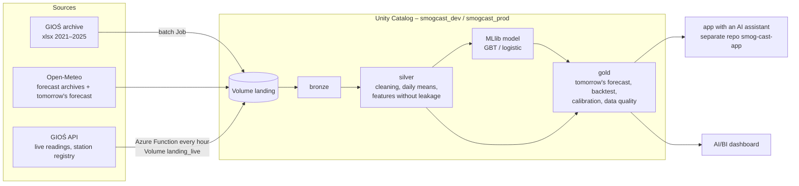

# smogcast – will the PM10 / PM2.5 limit be exceeded tomorrow in city Y?

**The app:** [ca-smogcast-app-dev.bravesmoke-11653194.polandcentral.azurecontainerapps.io](https://ca-smogcast-app-dev.bravesmoke-11653194.polandcentral.azurecontainerapps.io/)
(the app – repository `smog-cast-app` – is, or was, hosted at this address)

A data platform on Azure Databricks that answers one question every day:

> **"Will the daily PM10 / PM2.5 limit be exceeded tomorrow in city Y, and how sure is that?"**

for the 10 largest cities of Poland. The answer is a **probability** (0–100%) from a model trained on GIOŚ
measurements from 2021–2024 and Open-Meteo weather forecasts, checked on 2025, a year the model never saw – **in the
same cities it forecasts for**. The result is shown by an AI/BI dashboard and by an app with an AI assistant (separate
repository `smog-cast-app`); both read the gold tables.

Final project of a Databricks course (requirements: [`final-project-spec.md`](final-project-spec.md)).
State (2026-10-12): the pipeline runs on Databricks DEV on its schedule, as a service principal, and the app is
hosted on Azure Container Apps; PROD is in progress. Architecture, decisions and criteria:
[`ARCHITECTURE.md`](ARCHITECTURE.md).

---

## The result in short (test year 2025, 10 cities)

The trust criteria K1–K4 were frozen **before** training ([`ARCHITECTURE.md`](ARCHITECTURE.md), section 11.2). The
model gets tomorrow's weather from **real forecasts issued the day before**, not from the weather that happened.

| | PM10 (limit 50 µg/m³) | PM2.5 (threshold 25 µg/m³) |
|---|---|---|
| Brier: model / climatology / "tomorrow like today" | **0.0434** / 0.0615 / 0.0933 | **0.0751** / 0.117 / 0.172 |
| AUC | 0.95 | 0.94 |
| exceedance days caught (POD) / false alarms (FAR) | 44% / 32% | 70% / 27% |
| calibration (does "70%" mean 70%?) – largest gap | 8.5 pp (close to the limit) | 7.2 pp |
| **verdict K1–K4** | ❌ **fails** K4a (detection < 60%) | ✅ **passes** |

The PM10 model beats both simple rules and ranks days well, but it misses more than half of the exceedance days – this
is reported as it is instead of changing the criteria afterwards. Why PM10 is harder:
[`ARCHITECTURE.md`](ARCHITECTURE.md), section 6. The results are **identical locally and on Databricks**.

## Architecture in short



Three paths: **A – history and model** (batch), **B – live** (a declarative pipeline: deduplication, late readings,
quarantine, frozen / spike / drift flags, tomorrow's forecast), **C – CDC** of the station registry (snapshots → SCD2).
Full diagrams, tables and reasons: [`ARCHITECTURE.md`](ARCHITECTURE.md).

The main design decisions:
- **Every pipeline step is its own wheel** (`packages/<package>`), run by a Lakeflow Job task; shared code lives only
  in `smogcast-core`. The environments (local / dev / prod) differ only in a configuration file.
- **Features use only what is known when the forecast is issued** (today, 12:00 CET); the split is by time – training
  2021–2023 / validation 2024 / test 2025 – never random.
- **The model must beat two simple rules**: climatology and persistence ("tomorrow like today").
- **The app reads only the secured views** `gold_secure` (RLS/CLS) through a SQL Warehouse; numbers never come from a
  language model.
- **Dirty data for the demo** (`fault_replay`) is a copy of real readings with injected faults, on a separate track –
  it never touches the model's data.

## Technologies

Spark 4 / Databricks Runtime 17.3 LTS, Delta Lake, Unity Catalog (catalogs, schemas, volumes), Lakeflow Jobs, a
Lakeflow declarative pipeline (Auto Loader, expectations), Structured Streaming, Spark MLlib, an AI/BI dashboard, Azure
Functions, Databricks Asset Bundles, GitHub Actions with release-please, Terraform (separate repository
`smog-cast-terraform`). Locally everything runs in Docker.

## Running locally (Docker)

Requirement: Docker Desktop. Native Spark on Windows is not supported (Java 17, winutils) – everything goes through
`docker compose`.

```powershell
docker compose build                                              # once, a few minutes
docker compose run --rm smogcast smogcast steps                   # the steps of every wheel
docker compose run --rm smogcast smogcast run-batch               # history → model (real data, internet; long)
docker compose run --rm smogcast smogcast run-live                # tomorrow's forecast (after run-batch)
```

- Without internet: `smogcast --offline run-batch` – synthetic data in `data-offline/` (only to check the pipeline,
  **the results are not real**).
- Data-quality demo: `smogcast run-fault-demo` – the same faults from scratch every time; the live data is not
  touched.
- The data (`data/`) is created on the first run and is not in git. The sources and their pitfalls:
  [`ARCHITECTURE.md`](ARCHITECTURE.md), section 11.4.

## Tests and CI

```powershell
docker compose run --rm smogcast ruff check packages pipelines functions conftest.py
docker compose run --rm smogcast pytest -q -p no:logging -m "not integration"   # unit tests
docker compose run --rm smogcast pytest -q -p no:logging -m integration         # the whole pipeline on synthetic data (~3 min)
```

- **Unit tests** in `packages/<package>/tests/` – among others time conversions, data-quality rules, no leakage of the
  future into the features, metrics on hand-computed examples, reproducibility of the model, the RLS/CLS views.
- **Integration test** (`packages/cli/tests/test_integration.py`) – history → model → two live polls → the fault demo
  on synthetic data in the formats of the real sources; it checks the layers, idempotency, the verdict K1–K4, the
  forecasts and that every fault lands in the right place. It runs without internet.
- **CI** ([`.github/workflows/ci.yml`](.github/workflows/ci.yml)): on every commit of a pull request – lint → unit
  tests → integration test.
- **Deployment** ([`deploy.yml`](.github/workflows/deploy.yml),
  [`release-please.yml`](.github/workflows/release-please.yml)): a branch → DEV by hand; a merge to `main` → the
  release PR; merging the release PR → the tag `vX.Y.Z` → DEV automatically; the same tag → PROD by hand. On DEV
  GitHub signs in without a secret (OIDC).

## Deploying to Databricks

```powershell
databricks bundle validate -t dev
databricks bundle deploy -t dev                    # builds the 7 step wheels; 3 Jobs, the pipeline, the dashboard
databricks bundle run -t dev smogcast_batch        # history → model
databricks bundle run -t dev smogcast_live         # live → gold.forecast_tomorrow
```

- Bundle: [`databricks.yml`](databricks.yml) (targets `dev` and `prod`; the Jobs and the pipeline run as a service
  principal, PROD is deployed only by CI), resources: [`resources/`](resources/).
- Azure infrastructure (Key Vault + secret scope, the service principal with OIDC for GitHub Actions, groups for
  RLS/CLS, the catalog, the Azure Function polling the GIOŚ API with storage exposed as the volume
  `raw.landing_live`) – the separate Terraform repository `smog-cast-terraform`.
- **The GIOŚ API is polled by an Azure Function** [`functions/gios_poller/`](functions/gios_poller/) every hour (at
  :25 UTC), outside Databricks; the live Job runs 3 times a day (10:30, 16:30, 23:30 UTC) and processes the collected
  batches. Deploying the function's code: `bash functions/gios_poller/build.sh` (in Docker) →
  `az functionapp deployment source config-zip …`.

## Course requirements – where they are met

| Requirement | Where | State |
|---|---|---|
| medallion bronze → silver → gold, batch and streaming | paths A and B, `packages/*` | ✅ (locally and on DEV) |
| Unity Catalog: catalogs, schemas, volumes | Terraform `unity_catalog` (repository `smog-cast-terraform`) | ✅ DEV |
| RLS / CLS | dynamic views in `gold_secure` (step `gold governance`, dictionary `conf/gold_dictionary.yaml`): rows by voivodeship (`jurisdiction_code`), `technical` columns masked; the role comes from the table `ops.access_policy` or from the Terraform groups; the `gold` tables are for admins only; column descriptions and tags in Unity Catalog | ✅ DEV |
| secrets in Key Vault | Terraform `secrets`: Key Vault + the Key Vault-backed secret scope `smogcast`. The pipeline itself has no secret (the GIOŚ API and Open-Meteo need no key, the Azure Function writes with a managed identity); the secrets belong to the app: the language-model key and the OAuth secret of its service principal, which the hosted app reads from the vault through its managed identity | ✅ DEV |
| data quality, idempotency | `silver_clean` (quarantine, late readings, deduplication, flags), idempotent writes (`replaceWhere`, MERGE, an exactly-once stream + tables recomputed from bronze), the fault demo | ✅ |
| schema evolution | `mergeSchema` in incremental writes and **MERGE with schema evolution** (`core/storage.py`, test `test_storage.py`; used when `run_kind` was added to `gold.forecast_tomorrow`); Auto Loader in the declarative pipeline | ✅ |
| Lakeflow declarative pipeline + Lakeflow Job | Jobs: `resources/`; pipeline `smogcast-stream` (Auto Loader + expectations): `pipelines/`, `resources/pipeline_smogcast_stream.yml` | ✅ DEV |
| live ingestion | Azure Function `functions/gios_poller/` (Terraform `live_ingest`) → the external volume `raw.landing_live` → Auto Loader | ✅ DEV |
| tests (unit + data quality) in CI | `packages/*/tests`, the integration test, `ci.yml` | ✅ |
| Asset Bundle + CI/CD to PROD | `databricks.yml`; `deploy.yml` and `release-please.yml` | 🚧 DEV ✅, PROD in progress |
| a dashboard on gold | the AI/BI dashboard from the bundle (`resources/dashboard_smogcast.yml`, generator `dashboards/make_dashboard.py`): 7 pages on the `gold_secure` views (RLS/CLS for the viewer), refreshed after every run of the live Job (`dashboard_refresh`); the tables `gold.measured_daily` (what was measured) and `gold.forecast_verification` (the official forecast vs the measurement) | ✅ DEV |
| an AI app (RAG / assistant) | the separate repository `smog-cast-app` (Reflex; text-to-SQL with guardrails + RAG), reads `gold_secure` through a SQL Warehouse as its own service principal (role `analyst`) | ✅ DEV: hosted on Azure Container Apps |
| an advanced capability | **CDC** of the station registry → SCD2 | ✅ |

## Documentation

| Document | Contents |
|---|---|
| [`ARCHITECTURE.md`](ARCHITECTURE.md) | the whole system (pipeline, app with RAG, infrastructure): data flow, wheels, task graphs, tables, governance, model results, environments; section 11: definitions, criteria K1–K4, decisions D1–D17, data sources |
| [`final-project-spec.md`](final-project-spec.md) | the course requirements |

## Known limitations

- **PM10 fails the detection criterion** (44% < 60%), and the PM10 calibration passes with a small margin.
- The set of live stations is slightly larger than in the history (new stations), and "the city = its worst station" –
  so live features can be slightly higher than in training.
- Polish law has no daily PM2.5 limit today; the 25 µg/m³ threshold comes from the EU directive 2024/2881 (from 2030).
- The forecast is issued for a city, not for a district or a station.

## Data sources

Air-quality measurements: **Chief Inspectorate of Environmental Protection** (GIOŚ archive and API). Weather
forecasts: **Open-Meteo** (CC BY 4.0).
